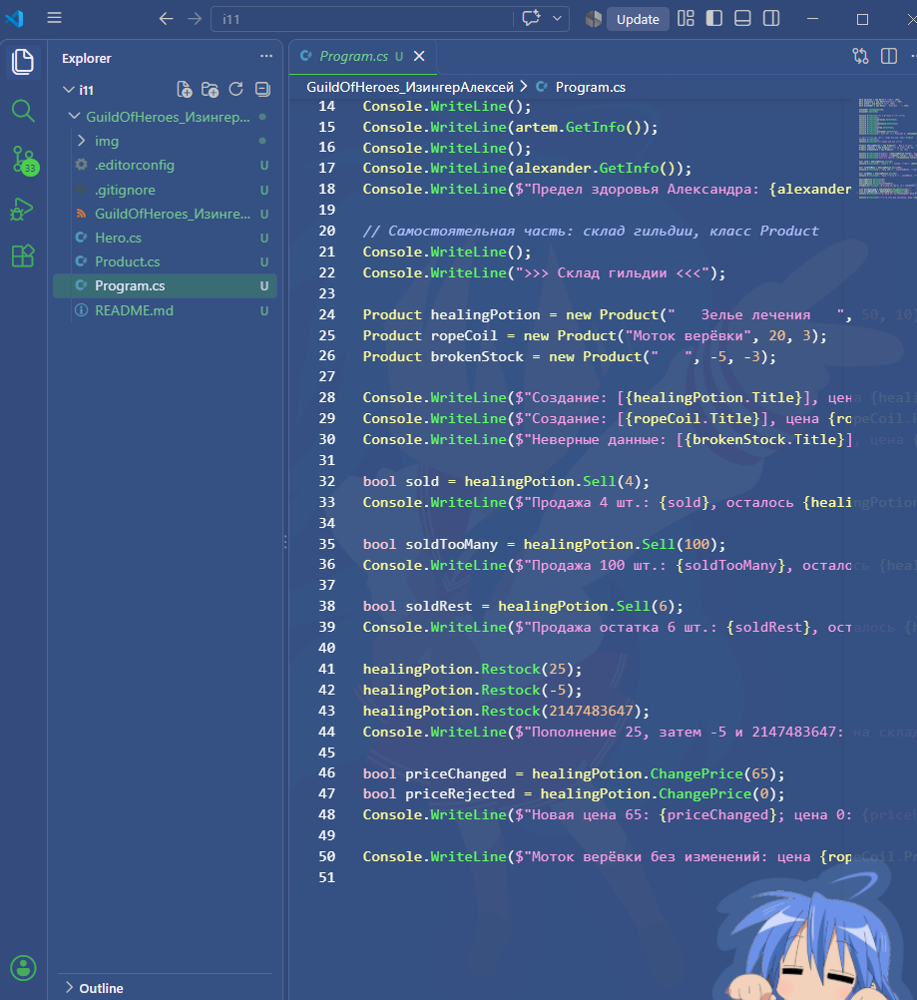
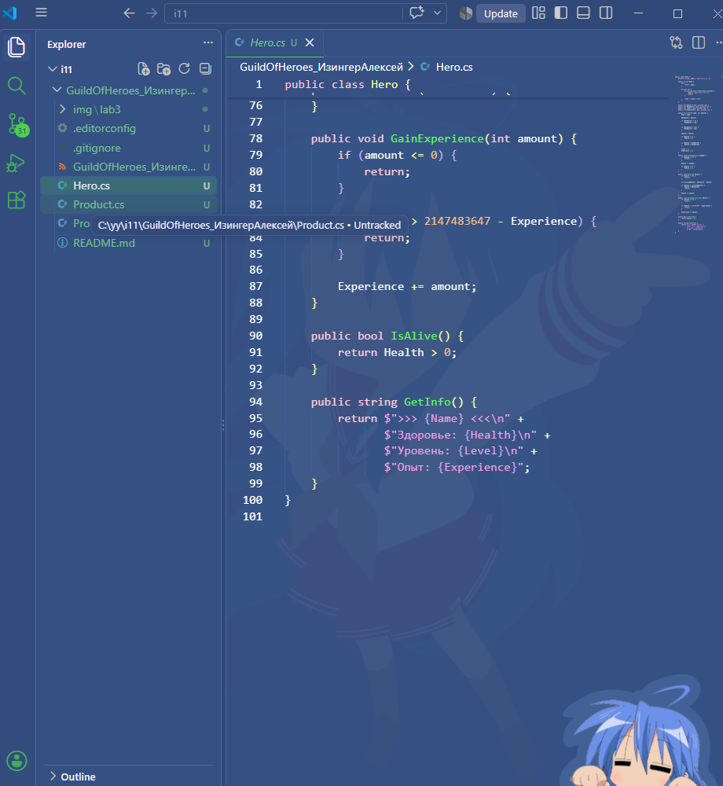
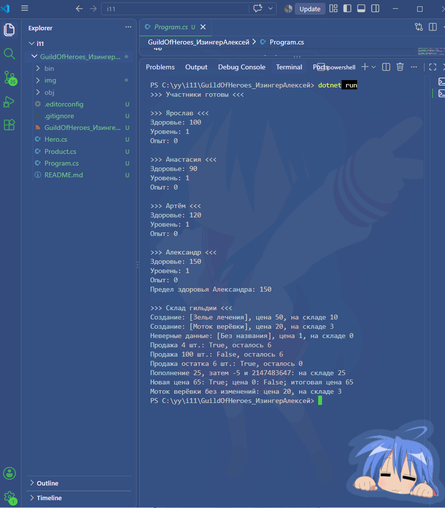
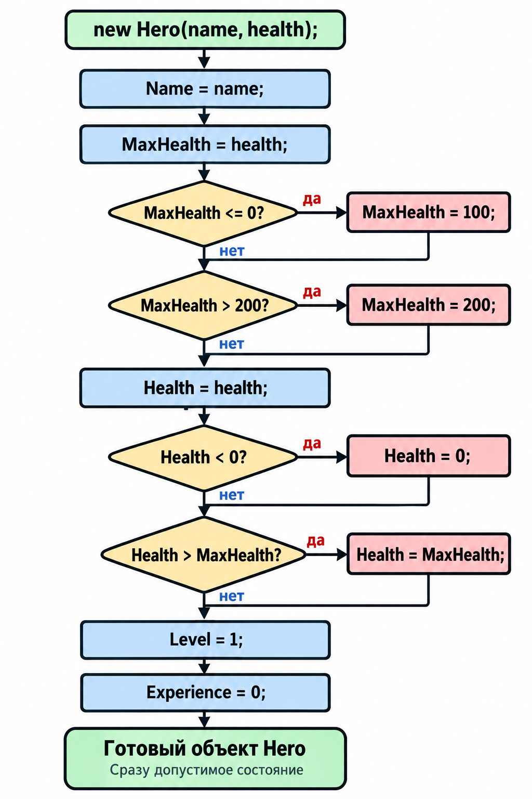

# Практическая работа № 11

**Студент:** Изингер Алексей
**Группа:** ИСП-242


## Приложение
Консольный проект на C#: учебная модель «Гильдии героев». В проекте класс `Hero`
(герой гильдии) и собственный класс `Product` (товар на складе гильдии).

Классы получили методы (`TakeDamage`, `Heal`, `GainExperience`, `IsAlive`, `GetInfo`
у `Hero`; `Restock`, `Sell`, `GetInfo` у `Product`). Данные пока хранятся в открытых полях.

Свойства и инкапсуляция. Работа выполнена в том же проекте `GuildOfHeroes`,
новый проект и репозиторий не создавались.

### Защита состояния Hero

Почему методы ПР №2 не защищали от прямой записи в поле:
`TakeDamage` и `Heal` проверяют число только тогда, когда их вызывают. Поле `Health` было `public`,
поэтому код в `Program.cs` мог выполнить `alexander.Health = 5000;` напрямую. Метод при этом не
вызывался, и ни одна проверка не срабатывала.

Чем отличаются get, set и private set:
`get` выполняется при чтении (`Console.WriteLine(alexander.Health)`), `set` — при присваивании
(`alexander.Health = 150`). Обычный `public set` разрешает присваивание любому коду, поэтому запись
`{ get; set; }` ничего не защитила: сменился синтаксис, а внешняя запись осталась. `private set`
оставляет запись только коду внутри `Hero` (конструктору и методам), читать значение по-прежнему
может любой. Если закрыть `private` всё свойство, то и читать `Health` из `Program.cs` станет нельзя.
При этом `private set` определяет, **кто** пишет, но не проверяет, **какое** число записывается.

Где проверяется начальное здоровье:
в конструкторе `Hero(string name, int health)`. Сначала определяется личный предел `MaxHealth`
(если передано `0` или меньше — `100`, если больше `200` — `200`, иначе равен переданному числу),
затем `Health` приводится к диапазону `0..MaxHealth`. Порядок важен: здоровье нельзя сравнивать
с ещё не подготовленным пределом.

Как Heal сохраняет границу MaxHealth:
метод вычисляет `missingHealth = MaxHealth - Health` — сколько не хватает до предела. Если лечение
не меньше недостающего, он ставит `Health = MaxHealth` и выходит, иначе делает `Health += amount`.
Так мы не складываем заведомо большие числа (нет выхода за диапазон `int`), а неположительное
лечение игнорируется в самом начале.

Как Name использует поле `_name` и значение `value`:
закрытое поле `_name` хранит строку. Свойство `Name` читает её через `get { return _name; }`, а запись
идёт через `private set`. При `Name = name;` содержимое параметра `name` становится `value` внутри
`set`. Там пустая строка или строка из пробелов заменяется на `"Безымянный герой"`, а остальное
сохраняется как `_name = value.Trim();`.

Почему в конструкторе используется Name = name:
эта запись запускает `set` с проверкой и `Trim()`. Если написать `_name = name;`, проверка была бы
обойдена внутри самого класса, и пробелы остались бы в имени.

### Проверки

Конструктор: входные значения и полученные Health / MaxHealth:

| Передано в конструктор | Health | MaxHealth |
| ---------------------- | ------ | --------- |
| `-100`                 | `0`    | `100`     |
| `0`                    | `0`    | `100`     |
| `120` (Артём)          | `120`  | `120`     |
| `150` (Александр)      | `150`  | `150`     |
| `200`                  | `200`  | `200`     |
| `5000`                 | `200`  | `200`     |

Урон и лечение: вызовы и фактические результаты (Александр, исходно `150/150`):

| Вызов                  | Health | Комментарий                                 |
| ---------------------- | ------ | ------------------------------------------- |
| `TakeDamage(30)`, затем `Heal(10)` | `130` | обычные действия                  |
| `Heal(5000)`           | `150`  | остановился на личном пределе               |
| `Heal(-20)`            | `150`  | отрицательное лечение отклонено             |
| `TakeDamage(5000)`     | `0`    | нижняя граница; `IsAlive()` вернул `False`  |
| `Heal(20)`             | `20`   | лечение из состояния `0` разрешено          |

Артём после всех вызовов Александра остался `120/120`: объекты независимы.

Имя: исходная строка и результат (в квадратных скобках видны пробелы):

| Исходная строка       | До изменения (поле)    | После (свойство + `Trim()`) |
| --------------------- | ---------------------- | --------------------------- |
| `"   Александр   "`   | `[   Александр   ]`    | `[Александр]`               |
| `"   "`               | `[   ]`                | `[Безымянный герой]`        |
| `""`                  | —                      | `[Безымянный герой]`        |


Опыт: `GainExperience(40)`, `GainExperience(-10)` и `GainExperience(2147483647)` дали опыт `40`
и уровень `1`. Прибавка `2147483647` отклонена целиком: она больше остатка диапазона `int`
(`2147483647 - 40`).

Какая внешняя запись не скомпилировалась и почему:
`alexander.Health = -100;` в `Program.cs`. Компилятор выдаёт ошибку `CS0272`: метод доступа `set`
у `Health` закрыт (`private`), поэтому присваивание снаружи класса запрещено — причём и для
допустимого числа тоже. Запрет относится к доступу, а не к значению.

### Исправление ошибок

1. Слишком открытое свойство.
   Ошибка: `public int Health { get; set; }` — из `Program.cs` можно выполнить `alexander.Health = -100;`.
   Исправление: `public int Health { get; private set; }`.
   Проверка: чтение работает, а присваивание из `Program.cs` не компилируется (`CS0272`). После удаления
   этой строки проект запускается и выводит четыре карточки.
   
2. Строка очищена только на словах.
   Ошибка: `value.Trim(); _name = value;`. Метод `Trim()` возвращает **новую** строку и не меняет
   исходную, а результат никуда не записан.
   Исправление: `_name = value.Trim();`.
   Проверка: для `new Hero("   Александр   ", 150)` было `[   Александр   ]`, стало `[Александр]`.
  
3. Проверка лечения перепутана.
   Ошибка: `if (amount >= 0) { return; }` в начале `Heal()`. Правильное лечение отбрасывается,
   а отрицательное проходит дальше.
   Исправление: `if (amount <= 0) { return; }`.
   Проверка: герой `100`, `TakeDamage(30)`, `Heal(10)`, `Heal(-10)`. С ошибкой получилось `60`, после
   исправления `80`.
  
4. Лечение уменьшает здоровье.
   Ошибка: `Health -= amount;` в конце `Heal()`.
   Исправление: `Health += amount;`.
   Проверка: герой `100`, `TakeDamage(30)`, `Heal(10)`. С ошибкой `60`, после исправления `80`.
  
5. Предел найден, но не соблюдён.
   Ошибка: `Health = amount;` внутри `if (amount >= missingHealth)`. Здоровье становится равным
   переданному лечению.
   Исправление: `Health = MaxHealth;`.
   Проверка: герой с пределом `150`, `TakeDamage(30)`, `Heal(5000)`. С ошибкой получилось `5000`,
   после исправления `150`.
  

### Ответы на вопросы этапа 12

1. Чем отличается запрет внешней записи от проверки допустимого числа? Где проверяются здоровье при
   создании и его изменение?
   Запрет (`private set`) отвечает на вопрос «кто может записывать», проверка числа — на вопрос
   «какое значение допустимо». Из-за `private set` строка `alexander.Health = -100;` не компилируется,
   но `new Hero("Проверка", -100)` без проверок в конструкторе всё равно создал бы героя со здоровьем
   `-100`, а `Heal(5000)` без проверки дал бы `5150`. Поэтому начальное здоровье проверяется в
   конструкторе (`Health` приводится к `0..MaxHealth`), а изменение — в `TakeDamage` (нижняя граница `0`)
   и `Heal` (верхняя граница `MaxHealth`).
2. Как `Name = name;` связывает параметр конструктора, `value` и поле `_name`?
   Аргумент `"   Александр   "` попадает в параметр `name`, при `Name = name;` становится `value` внутри
   `set`, проходит проверку и `Trim()`, и в `_name` сохраняется `"Александр"`.
3. Какие значения в проверках показали, что правило `0 <= Health <= MaxHealth` соблюдается?
   Конструктор: `-100 → 0/100`, `5000 → 200/200`. Методы: `Heal(5000)` остановился на `150/150`,
   `Heal(-20)` ничего не изменил, `TakeDamage(5000)` дал `0`, а не отрицательное число.
   Во всех случаях здоровье оставалось в диапазоне от `0` до личного предела.

### Итоговый запуск героев

`dotnet run` после этапа 11 выводит для героев:

```text
>>> Участники готовы <<<

>>> Ярослав <<<
Здоровье: 100
Уровень: 1
Опыт: 0

>>> Анастасия <<<
Здоровье: 90
Уровень: 1
Опыт: 0

>>> Артём <<<
Здоровье: 120
Уровень: 1
Опыт: 0

>>> Александр <<<
Здоровье: 150
Уровень: 1
Опыт: 0
Предел здоровья Александра: 150
```

Имя Александра очищено от пробелов, урон `10` и лечение `10` оставили здоровье `150`.
Ни одно состояние `Hero` не открыто для внешней записи: `_name` — закрытое поле, остальные данные
доступны только для чтения через свойства.

### Самостоятельный шаг: одно защищённое состояние (этап 10)

Свой класс — `Product` (товар на складе гильдии), файл `Product.cs`.

- **Выбранное правило.** Количество товара `Quantity` не бывает отрицательным: `Quantity >= 0`.
  Правило сформулировано до изменения кода.
- **Где оно проверяется.** Поле `Quantity` заменено свойством `public int Quantity { get; private set; }`.
  В конструкторе отрицательное начальное значение приводится к `0`. Метод `Sell(int amount)` отклоняет
  продажу, если `amount <= 0` или `amount` больше остатка. Метод `Restock(int amount)` игнорирует
  неположительное пополнение и такое, которое вышло бы за диапазон `int`.
- **Входные и фактические значения при неправильном действии.** Остаток `6`, `Sell(100)` → метод вернул
  `False`, на складе по-прежнему `6`. `new Product("   ", -5, -3)` → количество `0`. Присваивание
  `test.Quantity = -5;` из `Program.cs` не компилируется (`CS0272`).


### ПР №3. Инкапсуляция собственного класса

Класс и его назначение:
`Product` описывает товар на складе гильдии: название, цену и количество. Менять количество и цену можно
только через методы `Sell`, `Restock` и `ChangePrice`.

Какие данные защищены и почему:
`Quantity` (количество не бывает отрицательным), `Price` (цена не меньше `1`) и `Title` (название не
должно содержать лишних пробелов по краям и не быть пустым). Если разрешить менять их напрямую, любой
код смог бы записать `-5` штук или цену `0`.

Какие свойства имеют private set:
`Price`, `Quantity` и `Title`. Читать их можно из любого места программы, записывать — только внутри
`Product`.

Какое свойство использует закрытое поле:
`Title` использует поле `_title`. В `set` пустое значение заменяется на `"Без названия"`, остальное
сохраняется как `_title = value.Trim();`. `get` возвращает `_title`, а не `Title`.

Что проверяют конструктор и методы:
конструктор: `Title = title;` (запуск проверки названия), цена меньше `1` становится `1`, отрицательное
количество становится `0`. `Sell` отклоняет неположительное количество и количество больше остатка,
возвращая `false`. `Restock` игнорирует неположительное пополнение и пополнение, которое не помещается в
`int` (проверка `amount > 2147483647 - Quantity` стоит до сложения). `ChangePrice` отклоняет цену меньше `1`.

Проверки двух объектов и полученные результаты (`healingPotion` и `ropeCoil`):

| Проверка                                         | Результат                                           |
| ------------------------------------------------ | --------------------------------------------------- |
| Обычные данные: `"   Зелье лечения   "`, `50`, `10` | `[Зелье лечения]`, цена `50`, количество `10`    |
| Некорректные данные: `"   "`, `-5`, `-3`         | `[Без названия]`, цена `1`, количество `0`          |
| Допустимое действие: `Sell(4)`                   | `True`, осталось `6`                                |
| Недопустимое действие: `Sell(100)`               | `False`, осталось `6`                               |
| Граничное значение: `Sell(6)` (весь остаток)     | `True`, осталось `0`                                |
| `Restock(25)`, `Restock(-5)`, `Restock(2147483647)` | на складе `25` (отклонены `-5` и переполнение)   |
| `ChangePrice(65)` и `ChangePrice(0)`             | `True` и `False`, итоговая цена `65`                |
| Независимость объектов                           | `ropeCoil` остался с ценой `20` и количеством `3`   |

Полный вывод итогового запуска (герои и склад) заканчивается так:

```text
>>> Склад гильдии <<<
Создание: [Зелье лечения], цена 50, на складе 10
Создание: [Моток верёвки], цена 20, на складе 3
Неверные данные: [Без названия], цена 1, на складе 0
Продажа 4 шт.: True, осталось 6
Продажа 100 шт.: False, осталось 6
Продажа остатка 6 шт.: True, осталось 0
Пополнение 25, затем -5 и 2147483647: на складе 25
Новая цена 65: True; цена 0: False; итоговая цена 65
Моток верёвки без изменений: цена 20, на складе 3
```

### Расширенные проверки 

Блок временно добавлялся в конец блока героев и после проверки был удалён. Вывод:

```text
Начало: [Проверка] 120/120
Обычные действия: 105
Большое лечение: 120
Большой урон: 0; жив: False
После восстановления и неверных вызовов: 20
Опыт: 40; уровень: 1
Основной Александр: 150/150
```


Дополнительные границы: начальное здоровье `0` даёт `0/100`, `200` даёт `200/200`, имя `""`
превращается в `Безымянный герой`. Независимость объектов: после `alexander.TakeDamage(30)`
Александр `120/150`, а Артём остался `120/120`.


### Арифметика безопасного изменения чисел 

В `int` помещается конечный диапазон, поэтому `Health + amount` для очень большого `amount` мог бы выйти
за него. `Heal` сначала считает недостающую величину `MaxHealth - Health` и сравнивает с ней, а
`GainExperience` сравнивает прибавку с остатком диапазона `2147483647 - Experience` **до** сложения.
Это защита числа от переполнения, порогом нового уровня она не является: уровень в этой работе не
повышается.

### Дополнительные вопросы и памятка 

1. **Как открытое поле позволило обойти проверки `TakeDamage()`?** Проверки находятся внутри метода и
   работают, только если метод вызвали. `alexander.Health = 5000;` обращается к полю напрямую, метод не
   вызывается.
2. **Почему `{ get; set; }` само по себе не защитило здоровье?** Автоматическое свойство не содержит
   правил проверки, а `public set` по-прежнему разрешает запись любому коду. Сменился способ объявления,
   возможности записи остались прежними.
3. **Чем `private set` отличается от `private` у всего свойства?** При `public int Health { get; private set; }`
   читать значение можно везде, а записывать только внутри класса. При `private int Health { get; set; }`
   закрыто и чтение: из `Program.cs` нельзя даже вывести здоровье.
4. **Почему конструктор может присвоить `Health`, а `Program.cs` — нет?** Конструктор находится внутри
   класса `Hero`, а `private set` разрешает запись всему коду внутри этого класса.
5. **Почему после ограничения записи всё равно понадобились проверки конструктора и лечения?** `private set`
   не смотрит на число. `new Hero("Проверка", -100)` создал бы героя со здоровьем `-100`, а `Heal(5000)` дал
   бы `5150`, потому что конструктор и `Heal` имеют право записи. Допустимые значения должны проверяться
   именно там.
6. **Где хранится имя, что делает `value` и зачем нужен `Trim()`?** Имя хранится в закрытом поле `_name`.
   `value` — это значение правой части присваивания `Name = ...`, которое доступно внутри `set`.
   `Trim()` убирает пробелы по краям; он возвращает новую строку, поэтому результат нужно записать в `_name`.
7. **Почему `_name = name;` в конструкторе обошло бы проверку имени?** Эта запись напрямую меняет поле и
   не запускает `set` свойства `Name`, а значит, не выполняются ни `IsNullOrWhiteSpace`, ни `Trim()`.
8. **Как `Heal()` сохраняет правило `0 <= Health <= MaxHealth`?** Нижняя граница не нарушается, потому что
   лечение только прибавляет положительное число. Верхняя: при `amount >= missingHealth` здоровье ставится
   ровно в `MaxHealth`, иначе прибавка меньше недостающего и предел не превышается.
9. **Какие проверки в собственном проекте относятся именно к его предметной области?** Количество товара не
   отрицательно, продать больше остатка нельзя, цена не меньше `1`, пустое название заменяется на
   `"Без названия"`. Здоровье и предел героя здесь не используются.

Сравнение конструкций:

| Конструкция                               | Где хранятся данные                    | Что контролируем                           |
| ----------------------------------------- | -------------------------------------- | ------------------------------------------ |
| `public int Health;`                      | Непосредственно в открытом поле        | Внешняя запись ничем не ограничена         |
| `public int Health { get; set; }`         | В скрытом поле, созданном компилятором | Пока тоже нет ограничения внешней записи   |
| `public int Health { get; private set; }` | В скрытом поле, созданном компилятором | Записывать может только код внутри `Hero`  |
| Полное свойство `Name` с полем `_name`    | В явно объявленном закрытом поле       | Код в `set` проверяет и нормализует строку |

Для здоровья достаточно автоматического свойства, потому что правила изменения находятся в конструкторе и
методах. Для имени нужно полное свойство, чтобы проверка выполнялась при каждом присваивании через `Name`.
Свойство читается без круглых скобок (`alexander.Health`), у метода скобки нужны (`alexander.IsAlive()`).

___

## Скриншоты 












